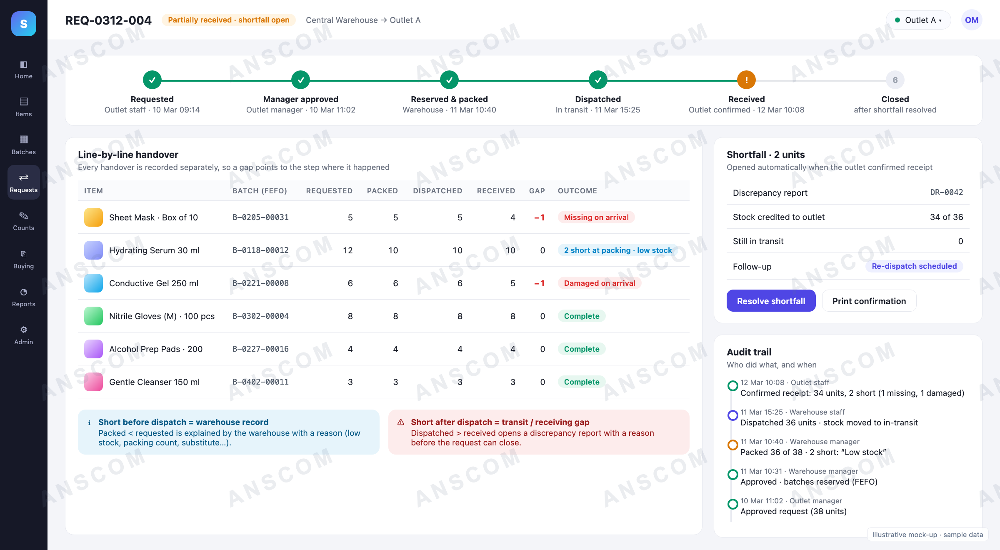

# Anscom — Software Engineering Portfolio 2026

Case studies of production systems I have designed and built. For each project I describe the
problem, the architecture, what I personally built, and the engineering decisions behind it.

> Most of this work was done for employers or clients, so the source code is not public.
> These pages are sanitised write-ups with illustrative mock-ups. See [DISCLAIMER.md](DISCLAIMER.md).

---

## Projects

| # | Project | Summary | Stack |
|---|---|---|---|
| 01 | [**Multi-Outlet Inventory & Procurement System**](project-01-inventory-system/) | Production inventory platform for a multi-outlet retail business: batch and expiry tracking, purchasing, warehouse-to-outlet stock requests, stocktakes and discrepancy resolution. Built solo, in daily use. | TypeScript · React · Node.js/Express · Firestore · Google Cloud Run |

*More projects will be added.*

---

### 01 · Multi-Outlet Inventory & Procurement System

[](project-01-inventory-system/)

The warehouse would say *"we sent 5"* and the outlet would say *"we received 4"*, and nobody
could prove where the missing item went. I built a system where every handover (packed,
dispatched, received) is recorded, and every gap has to have a reason before it can be closed.

- **Role:** sole engineer, from requirements to production support
- **Scale:** ~180k lines of TypeScript · ~130 REST endpoints · 7 user roles · 500+ commits in 7 months
- **Highlights:** transactional stock reservations · in-transit and partial deliveries ·
  stocktake variance control · on-device OCR purchase-order import · layered access control

**[Read the case study →](project-01-inventory-system/)**

---

## How each case study is organised

Every project folder follows the same layout:

```
project-XX-name/
├── README.md        Overview · Tech stack · Architecture · Key contributions · Engineering challenges
├── docs/            Deeper write-ups: architecture, decisions & trade-offs, lessons learned
└── images/          Illustrative mock-ups (sample data, watermarked)
```
