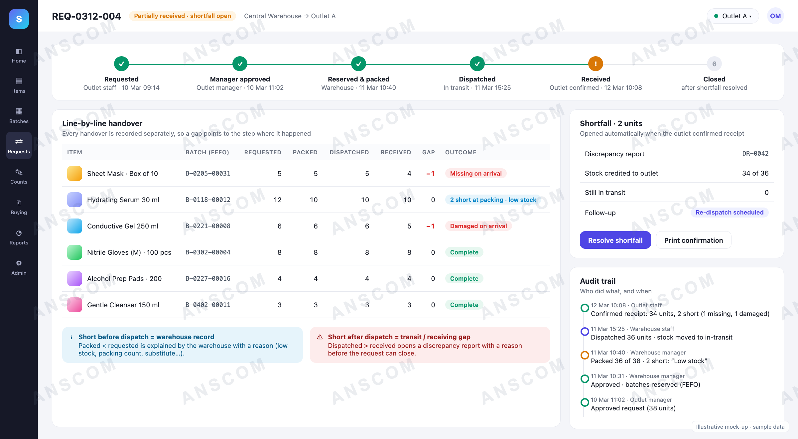
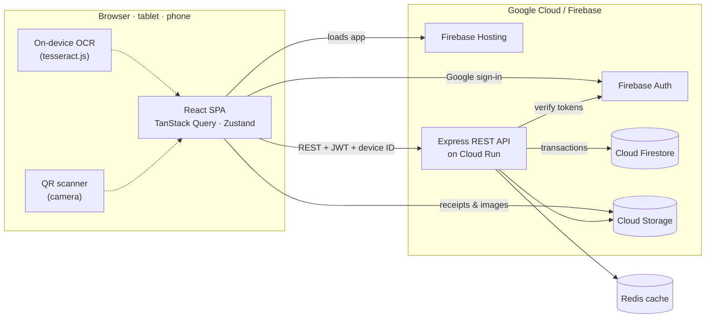
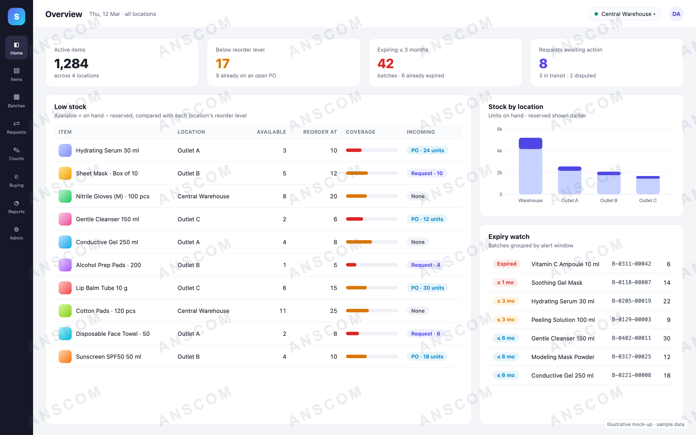
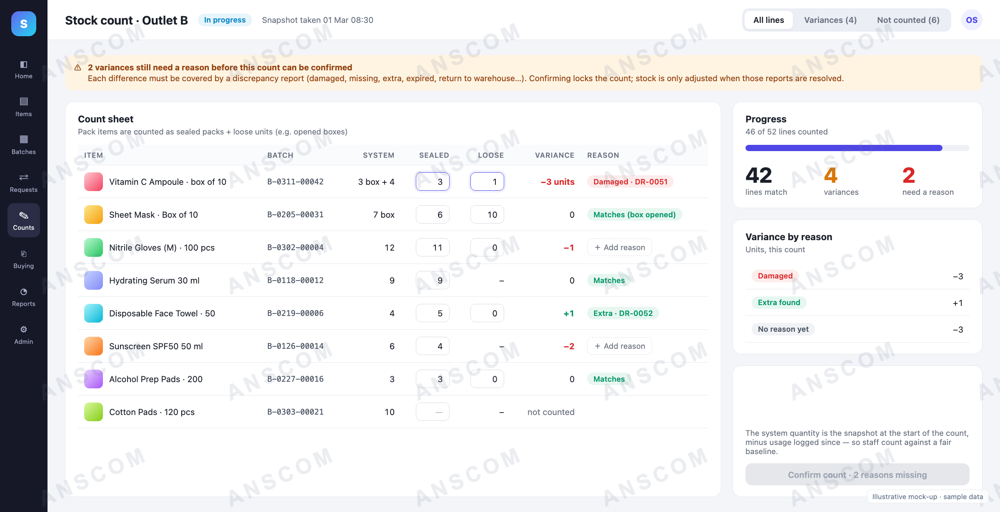
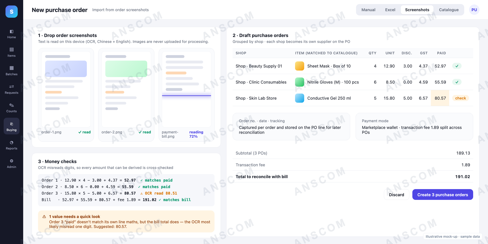
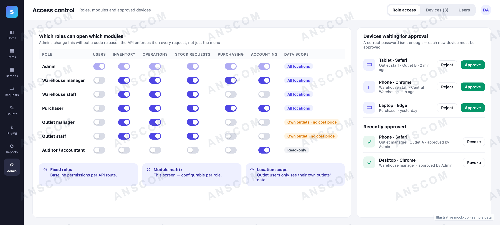
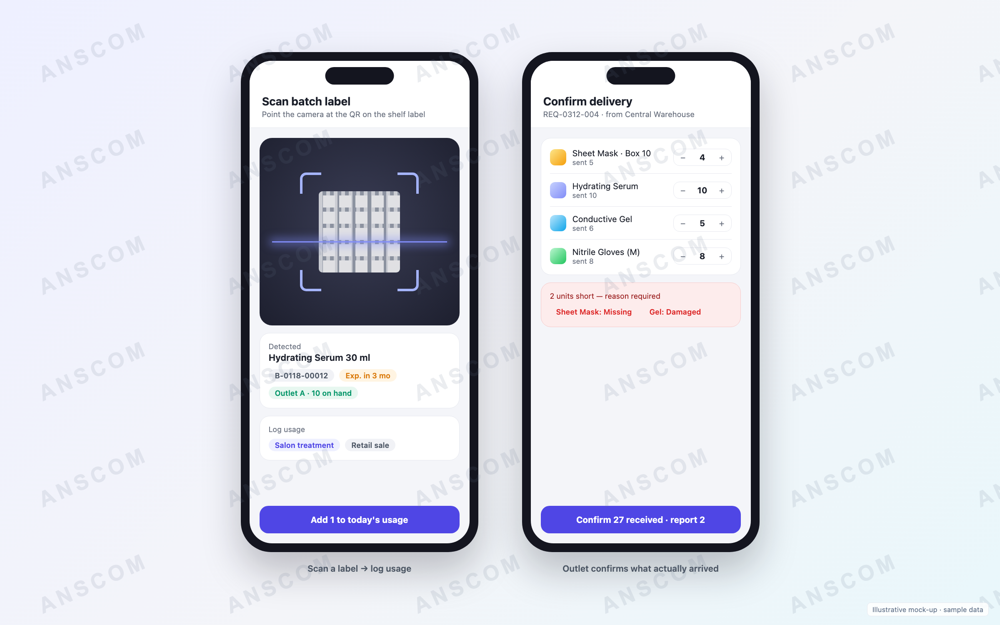

# Multi-Outlet Inventory & Procurement System

**Sole engineer · April 2026 – present · used daily by ~30 warehouse, outlet, purchasing and accounting staff**

`TypeScript` `React` `Node.js` `Express` `Firestore` `Google Cloud Run` `Firebase`

> **TL;DR:** I replaced spreadsheet-and-chat stock tracking for a multi-outlet retailer with
> one transactional system. Warehouse ↔ outlet delivery disputes went to **zero**, purchase-order
> entry dropped from **4 to 1.5 minutes**, and I designed, built and run it **solo**.
>
> **Engineers:** start with the [Technical Q&A](docs/technical-qa.md) (race conditions, crash
> recovery, what breaks at 100×) and [Engineering challenges](docs/engineering-challenges.md).

<sub>Source code is private (company system). Images are illustrative mock-ups with sample
data; see [DISCLAIMER](../DISCLAIMER.md).</sub>



**Contents:** [Overview](#overview) · [Tech stack](#tech-stack) · [Architecture](#architecture) ·
[Key contributions](#key-contributions) · [Engineering challenges](#engineering-challenges) ·
[Screens](#screens) · [Deeper docs](#deeper-docs)

---

## Overview

A beauty and aesthetics retail business runs one central warehouse that supplies several
outlets. Stock is a mix of retail products and consumables used in treatments, and most of it
has an expiry date.

**The problem.** Stock was tracked in spreadsheets and chat messages. The most painful result
was **disputes**: the warehouse would say *"we sent 5"* and the outlet would say *"we received
4"*. Nobody could prove where the missing item went, so nobody could say who should bear the
cost. There was also no clear view of what stock existed, where it was, or what was about to
expire.

**The solution.** One system covers the full stock lifecycle, and every quantity change is
attributable to a person, a time and a reason:

```
Supplier PO → shipment → receive into batches → warehouse stock
   → outlet request → approve → reserve → dispatch (in transit) → outlet confirms receipt
   → daily usage log → stocktake → discrepancy reports → accounting export
```

**Impact**

| | Before | After |
|---|---|---|
| Warehouse ↔ outlet delivery disputes | Recurring, unresolvable | **None:** every gap is traced to a step and a person |
| Time to enter a purchase order | ~4 min (manual retyping) | **~1.5 min** with screenshot import (**~60% faster**) |
| Database reads to load a product list page (25 items) | 100 | **4** (−96%) |
| Queries to load stock requests across outlets | up to 20 | **2** (−90%) |
| Users | — | **~30 staff** across warehouse, outlets, purchasing and accounting |

**Main features**

| Area | What it does |
|---|---|
| Batches & expiry | Every unit belongs to a batch with an expiry date. Expiry alerts and first-expiry-first-out (FEFO) picking. |
| Pack & loose units | Tracks sealed packs and opened units separately (for example, a box of 10 with 4 left). |
| Purchasing | Purchase orders, shipments, receiving into batches, refunds, GST and fees, payment modes. |
| Fast PO entry | Manual entry, Excel import, a catalogue picker, or **screenshots of online orders read by on-device OCR**. |
| Stock requests | Multi-stage approval → reservation → dispatch → receipt confirmation, with partial deliveries and shortfall handling. |
| Stocktake | Counts against a snapshot. Every variance needs a recorded reason before the count can close. |
| Daily usage | Outlets log retail and treatment usage by scanning QR batch labels. |
| Reporting | Low-stock alerts per location, expiry watch, reports, Excel accounting export and receipt downloads. |
| Access control | 7 roles, an admin-configurable permission matrix, outlet-level data scoping, device approval. |

---

## Tech stack

| Layer | Technologies |
|---|---|
| **Frontend** | React 18, TypeScript, Vite, TanStack Query, TanStack Virtual, Zustand, Tailwind CSS, Recharts, html5-qrcode, tesseract.js, ExcelJS |
| **Backend** | Node.js, Express, TypeScript, Zod, Firebase Admin SDK, JWT, bcrypt, helmet, express-rate-limit |
| **Data** | Cloud Firestore (document database), Cloud Storage (images and receipts), Redis (optional cache layer) |
| **Infrastructure** | Google Cloud Run (containerised API, scales to zero), Firebase Hosting (frontend), Firebase Authentication, Docker |
| **Tooling** | npm workspaces monorepo, TypeScript strict type-checking, Node test runner, 100+ scripted data migrations and imports |

---

## Architecture



**Every API request passes through the same pipeline:**


- **Frontend:** a single-page app that talks only to the REST API. It never reads or writes
  the database directly.
- **Backend:** a stateless Express API. Each feature module is split into routes →
  controller → service, and business rules live in the service layer.
- **Data:** Firestore collections for the catalogue, batches, stock levels, purchase orders,
  requests, stocktakes and discrepancy reports. Batch records are the source of truth;
  per-location stock totals are a derived cache rebuilt from them.

More detail: [docs/architecture.md](docs/architecture.md).

---

## Key contributions

I am the only engineer on this project, so I built everything below, from requirements to
production support.

- **Requirements and data model.** Turned the business's day-to-day operations into
  functional requirements, then designed the domain model: products, variants, batches,
  locations, reservations, movements, purchase orders, requests, stocktakes and discrepancy
  reports.
- **Stock-request workflow.** A multi-actor state machine (request → manager approval →
  warehouse reservation → dispatch → receipt) with partial deliveries, shortfalls,
  re-dispatch and expiry disputes. It is the largest module in the system.
- **Batch and quantity engine.** Batch-level stock with reservations, in-transit stock, FEFO
  allocation, and sealed/loose pack handling.
- **Procurement and accounting.** POs, shipments, transactional receiving with
  auto-generated batch numbers and QR labels, refunds, GST and fee calculations (unit
  tested), Excel export and receipt bundles.
- **Screenshot → PO import.** On-device Chinese and English OCR plus a parser that validates
  the money arithmetic and flags OCR misreads.
- **Security.** Custom JWT sessions alongside Firebase Auth, device approval, role and module
  permissions, outlet data scoping, and hiding cost prices from outlet staff.
- **Performance work.** Found and fixed the causes of slowdowns as data grew (see below).
- **Delivery and operations.** Docker and Cloud Run deployment, Firebase Hosting, data
  migration from the business's spreadsheets, and 100+ scripted imports, backfills and data
  repairs.

**By the numbers:** ~180k lines of TypeScript · ~130 API endpoints · ~30 pages · 20+ backend
modules · ~40 database transactions · 500+ commits over 7 months.

---

## Engineering challenges

### 1. Ending warehouse ↔ outlet disputes
**Problem:** "We sent 5" against "we received 4", with no evidence either way.
**Solution:** each handover is recorded separately: what the warehouse *packed* (with a
reason for any shortage), what was *dispatched* (stock moves into an in-transit state owned
by neither side), and what the outlet *confirmed* receiving. A gap after dispatch
automatically opens a discrepancy report with a reason (missing or damaged), and the
warehouse can re-dispatch the shortfall. A dispute now points to the step where the loss
happened. → [Deep dive](docs/engineering-challenges.md#1-ending-warehouse--outlet-disputes)

### 2. Several people changing the same stock at once
**Problem:** receiving, approving, dispatching and stock adjustments can hit the same batch
at the same moment, and a naive read-then-write loses updates.
**Solution:** every multi-document change runs in a database transaction (about 40 of
them). Reservation logic joins the caller's transaction, so "reserve stock" and "approve
request" succeed or fail together. Status is re-checked inside the transaction, which also
blocks double submissions (for example, receiving the same shipment twice).
→ [Deep dive](docs/engineering-challenges.md#2-concurrent-stock-changes)

### 3. Keeping stock totals accurate
**Problem:** "How much is at Outlet A?" must be fast to read but can never drift from
reality.
**Solution:** batch records are the single source of truth. Per-location totals (on hand,
reserved, available, near-expiry, expired) are **recalculated from the batches** after each
change instead of being incremented, so any error corrects itself the next time the item
changes, and one command can rebuild every total.
→ [Deep dive](docs/engineering-challenges.md#3-stock-totals-that-cannot-drift)

### 4. Slow pages as data grew
**Problem:** real usage made key pages noticeably slower. There was no single bug; it had
several separate causes.
**Solution:**

| Cause | Fix |
|---|---|
| 4 database reads *per product* on list pages (100 reads for a 25-item page) | Batched reads: **4 per page** (−96%; up to 400 → 4 at 100 items) |
| Reference data re-read on every request | Cache that expires after a set time, cleared on every write (in-memory + Redis) |
| Role lookup on every request | Roles embedded in the signed login token (**−1 database read on every API call**) |
| Up to 20 queries, one per outlet | `in` queries backed by composite indexes: **2 queries** (−90%) |
| Thousands of table rows rendered at once | Virtualised scrolling |
| Placeholder rate limiter | Real rate limiting |

→ [Deep dive](docs/engineering-challenges.md#4-performance-under-growing-data)

### 5. Turning unreliable OCR into correct money data
**Problem:** purchasers buy from a Chinese e-commerce app and used to retype every order
(about 4 minutes per PO). OCR saves the typing but regularly misreads digits.
**Solution:** OCR runs **in the browser** (no API cost, and images never leave the device).
A parser cross-checks every amount that can be derived (unit price × quantity − discount +
GST = amount paid, and the sum of orders + fee = bill total) and flags mismatches for a quick
human check instead of trusting the OCR. **PO entry dropped from about 4 minutes to about
1.5 minutes.**
→ [Deep dive](docs/engineering-challenges.md#5-validating-ocr-output)

---

## Screens

*Illustrative mock-ups with sample data. The real UI differs.*

| | |
|---|---|
|  **Overview:** low stock per location, expiry watch, requests needing action |  **Stocktake:** sealed and loose counting; the count can't be confirmed until each variance has a reason |
|  **Screenshot → PO:** on-device OCR with money cross-checks |  **Access control:** role × module permissions and device approval |


**Mobile:** outlet staff scan batch labels to log usage and confirm deliveries line by line.

---

## Deeper docs

| Document | What's inside |
|---|---|
| [Architecture](docs/architecture.md) | Components, request pipeline, data model, key workflows (diagrams) |
| [Engineering challenges](docs/engineering-challenges.md) | The five problems above in depth: approach and alternatives |
| [Design decisions & trade-offs](docs/design-decisions.md) | Why Firestore, Cloud Run, on-device OCR, layered permissions… and what each choice cost |
| [Lessons learned](docs/lessons-learned.md) | What worked, what I'd do differently, what's next |
| [**Technical Q&A: the hard questions**](docs/technical-qa.md) | 22 senior-level questions answered: race conditions, crash recovery, idempotency, security trade-offs, what breaks at 100× scale |
