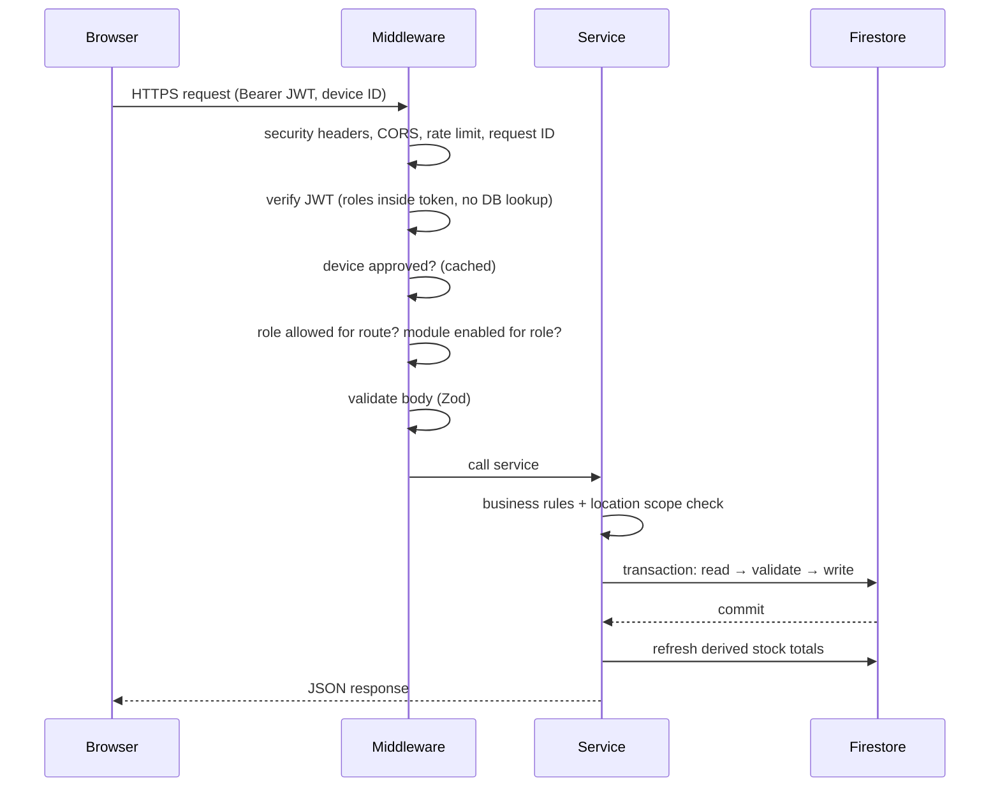
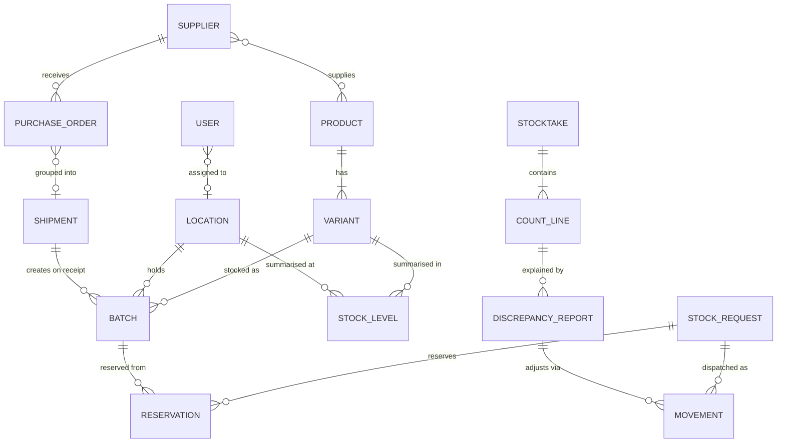
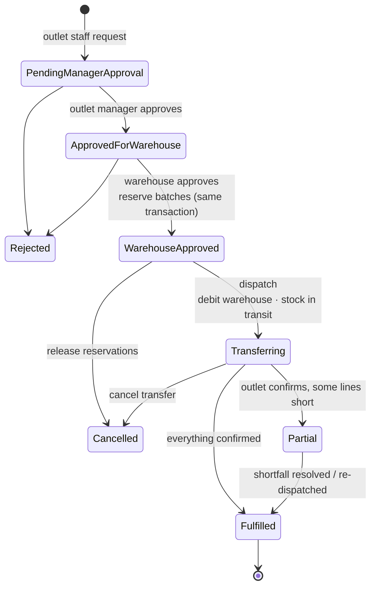
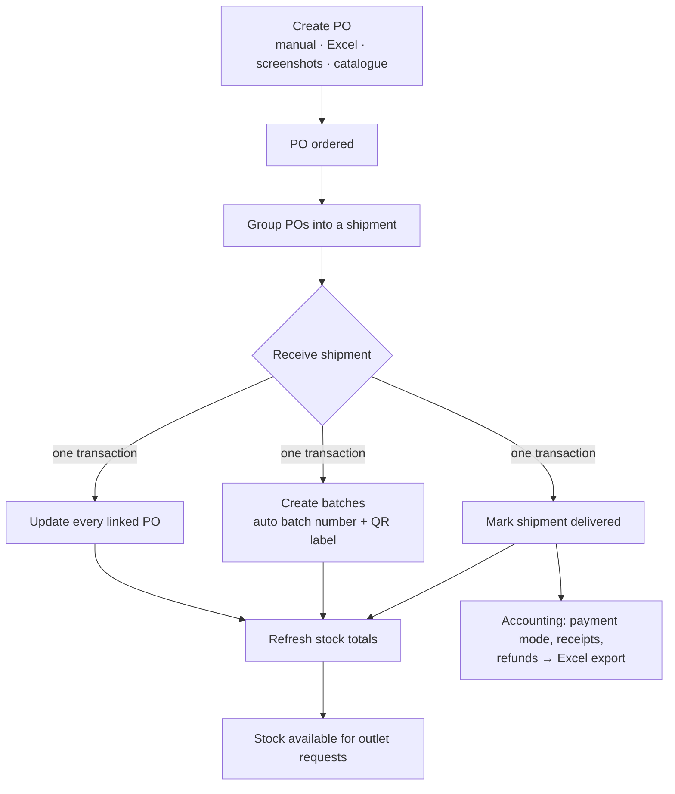
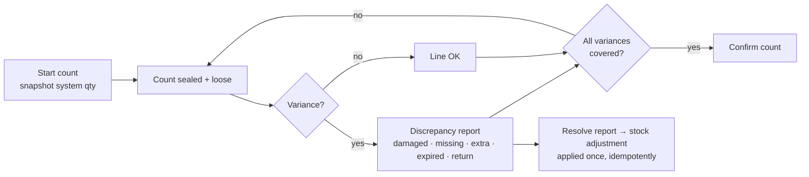
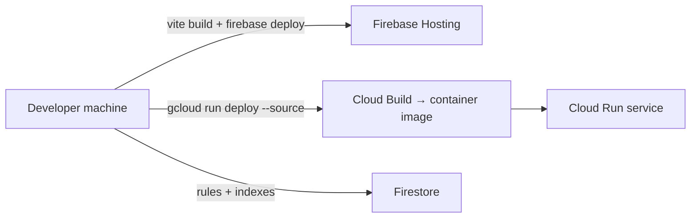

# Architecture

[← Back to case study](../README.md)

## 1. Components

| Component | Technology | Responsibility |
|---|---|---|
| Web app | React 18 SPA on Firebase Hosting | All user interfaces: desktop for warehouse and admin, mobile for outlets |
| API | Node.js + Express on Google Cloud Run | Authentication, authorisation, validation, business rules, transactions |
| Database | Cloud Firestore | System of record for all business data |
| File storage | Cloud Storage | Product images, receipt files |
| Identity | Firebase Authentication | Google sign-in; token verification |
| Cache | In-memory + Redis | Reference data (brands, categories, suppliers…), user scope lookups |

The browser talks to Firestore **only through the API**, so every rule is enforced in one
place on the server. The Firebase SDK in the browser is used only for sign-in and file
uploads.

## 2. Backend structure

```
src/
├── app.ts               middleware chain + route mounting
├── middleware/          auth · roles · module gate · validation · rate limit · request ID · errors
├── modules/<feature>/   one folder per business area
│   ├── *.routes.ts      URL + permissions + validation schema
│   ├── *.controller.ts  HTTP in/out
│   ├── *.service.ts     business rules + database transactions
│   └── *.types.ts/dto   types and Zod schemas
└── common/              shared errors, caching, pagination, location scoping
```

Feature modules include products and catalogue, batches, stock levels, reservations,
movements, purchase orders, stock requests, usage logging, stocktake, discrepancy reports,
notifications, reorder levels, users, roles and access, and device approval.

**Error handling:** one error type (`code`, `message`, `HTTP status`, `details`) and one
central handler that returns a consistent JSON shape with a request ID. Unexpected errors are
logged with full detail but returned to the client as a generic message.

## 3. Request pipeline



## 4. Data model (simplified)



**Modelling principles**

- **Batch = source of truth.** A batch holds the variant, location, supplier, expiry date,
  sealed quantity, loose quantity and reserved quantity.
- **Stock level = derived cache.** One document per (location, variant) holds on hand,
  reserved, available, near-expiry and expired. It is always rebuildable from batches.
- **Deliberate denormalisation.** Firestore has no joins, so display data that is needed
  together is copied at write time, for example batch details on a transfer, or the shipment
  number on its purchase orders.
- **Counters inside transactions.** PO numbers, shipment numbers and per-day batch numbers
  are allocated atomically.

## 5. Key workflows

### Stock request lifecycle



### Purchase order → stock



### Stocktake → discrepancy resolution



## 6. Deployment



- One production environment plus local development. Configuration comes from environment
  variables, and secrets are never committed.
- Logs are structured JSON written to stdout and collected by Cloud Logging. Every request
  has a request ID that also appears in error responses.
