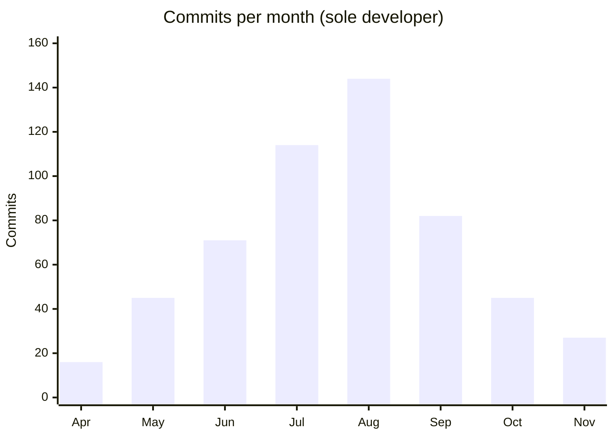

# How the System Evolved

[← Back to case study](../README.md)

The system wasn't specified up front and then built. It grew month by month alongside the
business, shipped in small increments, and was shaped by feedback from the people using it
every day. This timeline comes from the project's commit history.

## Delivery activity

November is partial (to mid-month). 540+ commits in total, all by me.

The shape is typical of a real rollout: a quick foundation, a steep climb as each team
adopted the system and asked for changes, a peak during hardening, then a shift to
improving efficiency rather than adding scope.

## Timeline

| Month | Phase | What shipped |
|---|---|---|
| **Apr** | Foundation | Project scaffold, product catalogue with variants, batches, locations, suppliers, outlet roles, stock movements, first version of purchase orders |
| **May** | Core operations loop | Warehouse ↔ outlet stock requests, stocktake, daily usage logging with QR scanning, discrepancy reports, partial deliveries, retail versus treatment usage, shipment tracking, first role-access controls |
| **Jun** | Accountability & finance | **Performance fixes** (batched reads, caching, roles in the token, fewer queries); shortfalls automatically open discrepancy reports; re-dispatch; accounting page and Excel export; payment modes; receipt uploads; reports page; scripted data imports |
| **Jul** | Adoption across all outlets | Product substitutions, tablet-friendly request screens, expiry differences flagged on receipt, warehouse shortage reasons, picklists, batch barcodes, clearer pack and unit displays |
| **Aug** | Hardening | **Stock reservations at approval**, **device approval**, **admin-configurable role-access matrix**, PO refunds, printable handover forms, barcode scanner, request caching, accounting receipt bundles |
| **Sep** | Procurement depth | Purchaser role, purchase orders from multiple suppliers, refunds per item, marketplace platforms per supplier, payment currencies |
| **Oct** | Faster data entry | Excel PO templates, **screenshot → PO import with on-device OCR**, purchaser catalogue page, double-receive guard on shipments, autosaved request drafts |
| **Nov** | Insight & polish | Low-stock alerts per location, location codes, camera capture for product photos, accounting export filters |

**Milestones**
- **~6 weeks** from the first commit to a working core loop (request → approve → dispatch →
  receive → count → explain the differences).
- **Week 7:** performance work once real data volumes showed the slowdowns (see
  [engineering challenges §4](engineering-challenges.md#4-performance-under-growing-data)).
- **Month 4:** security and consistency hardening (reservations, device approval, role
  matrix), once the system was carrying real business data.
- **Months 6–7:** attention moved from "can the system do it?" to "how fast can staff do
  it?" (OCR import cut PO entry from about 4 minutes to about 1.5).

## What drove the changes

Most features came from how the system was used day to day rather than from a spec:

| Need that came up in daily use | What I changed |
|---|---|
| Outlets received items whose expiry dates differed from what was sent | An expiry-difference flow when receiving, so the mismatch is recorded instead of silently accepted |
| Following up on shortfalls depended on someone remembering | Shortfalls automatically open a discrepancy report, and the warehouse can re-dispatch |
| Approved stock needed to be held so it couldn't be promised to another request before packing | Stock is reserved against specific batches at approval time |
| Outlet tablets and phones were shared between staff | Device approval on top of passwords, and confirmations record *who* received the goods |
| Management wanted to give accounting access to an existing role | A configurable role × module matrix instead of a new hard-coded role |
| Purchasers spent minutes retyping each online order | Screenshot import with on-device OCR and arithmetic cross-checks |

## How I shipped safely without a big team

- **Small, frequent releases.** Each change was small enough to verify by hand the same day.
- **Scripted data changes only.** Every import, migration and data correction was a
  reviewed, re-runnable script (100+ in total), never a hand edit in the database.
- **Additive changes.** New layers were added beside existing behaviour (for example, the role
  matrix on top of fixed roles, and reservations inside existing transactions) instead of
  rewriting working flows.
